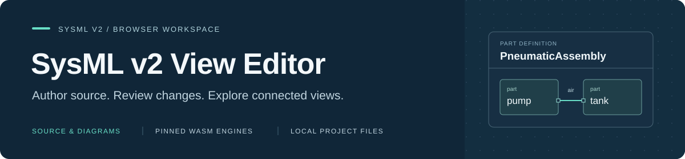
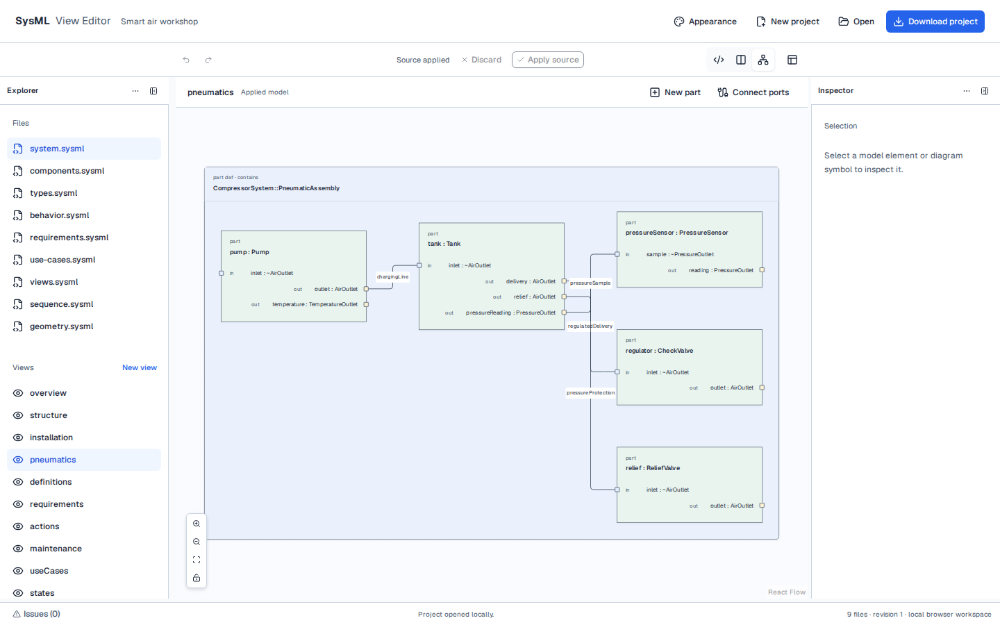

<p align="center">
  
</p>

<h1 align="center">SysML v2 View Editor</h1>

<p align="center">
  Work with SysML v2 source and diagrams in your browser.<br />
  Review graphical edits as source changes, and keep your project in local files.
</p>

<p align="center">
  <a href="#scope"></a>
  <a href="LICENSE"></a>
  <a href=".nvmrc"></a>
  <a href="src/"></a>
  <a href="docs/architecture/README.md"></a>
</p>

<p align="center">
  <a href="#quick-start">Quick start</a> ·
  <a href="#features">Features</a> ·
  <a href="#examples">Examples</a> ·
  <a href="#modeling-engines">Modeling engines</a> ·
  <a href="#documentation">Documentation</a> ·
  <a href="CONTRIBUTING.md">Contributing</a> ·
  <a href="SECURITY.md">Security</a>
</p>

---

> **Sandbox stage** — Actively iterating on the design and implementation. Features, interfaces and workflows may change. Not intended for production use.

SysML v2 View Editor brings source editing, named model views and reviewed graphical authoring into one local workbench. Open a multi-file model, inspect its structure and connections, review supported edits, then download the source and compatible diagram positions as one project.

**Source owns model semantics. Presentation owns geometry.** Renaming a part or connecting ports produces a reviewed source transaction; moving a symbol changes its position. The application runs locally in browser workers and requires no application backend.

<p align="center">
  
</p>

<p align="center"><em>Smart air workshop: a pneumatic assembly with typed ports and authored connections.</em></p>

## Features

- **Edit source with retained drafts.** Apply or discard changes, undo/redo accepted source transactions, and keep the last valid model when a draft fails validation.
- **Open source-defined views.** Navigate named SysML views independently of the active source file. Inspect nested parts, typed inherited ports and resolved connection endpoints.
- **Browse the model hierarchy.** Expand packages, definitions and declared members in the Model tree. Inspect type/kind labels; use arrow keys, type-ahead and Enter/Space to navigate and select.
- **Review graphical changes.** Rename parts, create native views, add typed part usages and connect compatible directed ports through an exact source-change preview.
- **Preserve compatible layouts.** Keep verified symbol positions across supported edits, including inactive views. Unsafe identity mappings are reported and arranged again.
- **Keep projects portable.** Download applied source, unfinished drafts and compatible diagram positions together; reopen the bundle or import multiple SysML files.
- **Arrange your workspace.** Resize or collapse Explorer, Inspector, source/diagram panes and Issues using dividers, keyboard controls or panel options.
- **Choose your appearance.** Use Light, Dark or Follow system, six diagram palettes and custom muted element colors. Theme and panel preferences stay in the browser.

Structural workflows have real-engine browser coverage; behavior, use-case, state, sequence and geometry renderers remain unavailable. See [capabilities and limits](docs/capabilities.md) and [local verification](docs/verification.md) for the implemented scope.

## Quick start

### 1. Install and run

Use **Node.js 26.3.1** from [`.nvmrc`](.nvmrc) and **npm 11.16.0**. From the repository root:

```bash
npm ci
npm run dev -- --host 127.0.0.1
```

Open the URL printed by Vite. The first dev/build verifies and prepares checksum-pinned browser engines. It needs network access, `tar` and disk space for the Go build cache. Linux x64 can download the pinned Go 1.25.11 toolchain into ignored `sandbox/`; on other platforms, set `SYSML_GO` to that Go version's binary. Later runs verify and reuse prepared assets. See [engine preparation](engine-bridge/README.md).

### 2. Explore the startup model

**Smart air workshop** opens automatically in Diagram mode. Its nine source files and fourteen named views cover reusable definitions, specialization, attributes, constraints, requirements, actions, states, use cases, sequences and geometry.

The starting **pneumatics** view shows the pump, tank, regulator, relief valve and pressure sensor, with thirteen ports and four connections:

1. Select another named view in Explorer to explore its contents.
2. Choose **Split** to see source beside the diagram; selecting a source file keeps the active view open.
3. Edit source and choose **Apply source**. Invalid drafts retain the previous applied model and appear in **Issues**.
4. Choose **Download project** to save your work before closing or reloading.

Six startup views have partial structural/definition/tree rendering. The other eight evaluate through the engine and display an explicit unavailable-renderer message. The [model guide](examples/air-compressor/README.md) lists each view's current support.

### 3. Try graphical authoring

Use **Open** to select both SysML files from [`examples/assembly/`](examples/assembly/), then open `structure`:

- Select a part in Model or the diagram to review a rename.
- Choose **New part** in the diagram or **New part in selection** in the Inspector. Select an owner, name and existing part definition, then review and apply the change.
- Choose **Connect ports**, or select a directed port and choose **Connect selected port**. Select compatible usage-qualified endpoints, then review and apply the connection.
- Use source undo/redo, switch views and download/reopen the project to continue working.

Connection creation currently requires explicit compatible directions and identical resolved port types. Conjugated and ambiguous endpoint paths are unavailable for graphical creation. [Authoring workflow and supported subset](docs/architecture/graphical-authoring.md).

## Examples

Open all `.sysml` files from one example folder together. Each project has its own named views and recorded visual targets.

| Project                                                                                                                                                                 | Explore                                                                                                                |
| ----------------------------------------------------------------------------------------------------------------------------------------------------------------------- | ---------------------------------------------------------------------------------------------------------------------- |
| [Smart air workshop](examples/air-compressor/README.md)                                                                                                                 | A complete nine-file example spanning structure, requirements, behavior and geometry; the startup project              |
| [Nested assembly](examples/assembly/)                                                                                                                                   | Nested ownership, repeated usages, inherited ports, a connection and reference notation; the focused authoring fixture |
| [Parts](examples/parts/), [ports](examples/ports/) and [packages](examples/packages/)                                                                                   | Shared definitions, usage contexts, conjugation, imports and exposure                                                  |
| [Requirements](examples/requirements/), [use cases](examples/use-cases/), [actions](examples/actions/), [states](examples/states/) and [sequences](examples/sequences/) | Source constructs and named views, including explicit unavailable-renderer cases                                       |
| [Complete example library](examples/README.md)                                                                                                                          | Comments, documentation, filters, empty views and per-view support gaps                                                |

Engine evaluation, application rendering and intended visual quality are recorded separately. Passing an example does not establish full SysML v2 conformance.

## Modeling engines

The editor uses both OpenSysML and SysML Toolkit locally as WebAssembly in disposable browser workers:

| Engine        | Role in this editor                                                                                                                                      |
| ------------- | -------------------------------------------------------------------------------------------------------------------------------------------------------- |
| OpenSysML     | Parses and validates source, resolves declarations and types for model inspection, and evaluates named SysML views into semantic diagram data.           |
| SysML Toolkit | Proposes source transformations for rename, new view, new part and connect ports, returning edit evidence used to preserve compatible diagram positions. |

- **Apply source:** OpenSysML parses and validates the edited source; affected views are reevaluated.
- **Graphical authoring:** Toolkit proposes a source change, OpenSysML validates the complete result, and the workspace checks the command's intended outcome before review and acceptance.
- **Move symbols:** only presentation geometry changes; moving a symbol does not transform semantic source.

React Flow draws the interactive diagrams and ELK supplies automatic layout. The workspace owns drafts, transaction acceptance, undo/redo and layout-preservation rules. See [engine pins, preparation and provenance](engine-bridge/README.md) and the [workspace architecture](docs/architecture/README.md).

## Projects and workspace

**Download project** saves one `.sysml-project.json`; **Open** accepts that bundle or multiple `.sysml` files. Downloads do not write back to the imported folder. There is no automatic work-recovery store, so retain the downloaded project to preserve source and drafts across reloads.

| Data                                                             | Where it lives                                        |
| ---------------------------------------------------------------- | ----------------------------------------------------- |
| Applied source, unapplied drafts and compatible symbol positions | Downloaded project bundle                             |
| Theme, palette, custom colors and panel arrangement              | Browser preferences; separate from project content    |
| Undo history, selection and camera                               | Current session; not restored from the project bundle |

Drag a divider or focus it and use arrow keys to resize a panel. Header options provide button alternatives. Reopen collapsed tools from their edge rails, open **Issues** from the footer, or use **Workspace layout** to adjust/reset the arrangement. Below 900 px, the source/diagram split becomes vertical. [Panel behavior](docs/architecture/workbench-layout.md).

Use **Appearance** for Light/Dark/System, palettes and custom muted fills. Preferences never modify source, project files or model undo history. [Design system](docs/design-system.md).

## Development

Use the committed npm lockfile and the Node version in `.nvmrc`.

If `just` is installed, the root `justfile` provides shortcuts for the npm scripts. Run `just` to list commands:

```bash
just install                        # npm ci
just dev --host 127.0.0.1
just check
just build
just install-browser
just test-e2e --project=functional --grep 'downloads and reopens'
just preview --host 127.0.0.1
```

Script names containing colons use hyphens in recipes: `just engines-prepare`, `just check-architecture`, `just examples-index`, `just test-examples` and `just test-e2e`. Recipes with arguments forward them to the underlying command, preserving quoted values. Node selection and npm scripts remain unchanged; `just` is optional.

```bash
npm run check                       # formatting, architecture, types and unit checks
npm run build                       # prepare engines and build static output
npx playwright install chromium
npm run test:e2e                    # fresh build, real engines and visual comparisons
npm run preview -- --host 127.0.0.1
```

Functional checks can use installed Chrome with `PLAYWRIGHT_BROWSER_CHANNEL=chrome npm run test:e2e -- --project=functional`. Visual comparisons always use bundled Chromium and reviewed platform-specific baselines. The browser suite starts its own fresh production server; port **4175** must be free. See [browser testing and baseline review](docs/testing.md).

For example changes, run `npm run test:examples`; use `npm run examples:index` after updating the catalog. `npm run format` formats owned source and docs; `npm run lint` checks formatting and architectural imports. Keep temporary files, reports and captures under ignored `sandbox/`.

## Documentation

| Guide                                                               | What you will find                                                       |
| ------------------------------------------------------------------- | ------------------------------------------------------------------------ |
| [Capabilities](docs/capabilities.md)                                | Supported workflows and current limits                                   |
| [Architecture](docs/architecture/README.md)                         | Module ownership, engine boundaries and source transactions              |
| [Project format](docs/architecture/project-format.md)               | Source, drafts, identity and presentation serialization                  |
| [Graphical authoring](docs/architecture/graphical-authoring.md)     | Reviewed creation/rename, command validation and failure behavior        |
| [Layout preservation](docs/architecture/identity-reconciliation.md) | Verified correspondence, bounded source edits and unsafe mappings        |
| [Workbench panels](docs/architecture/workbench-layout.md)           | Resizing, focus, toolbar layout and browser preferences                  |
| [Design system](docs/design-system.md)                              | Shared controls, typography, appearance and registry workflow            |
| [Testing](docs/testing.md)                                          | Real-engine scenarios, visual comparisons and failure artifacts          |
| [Verification](docs/verification.md)                                | Local results, retained evidence and skipped coverage                    |
| [Next steps](docs/next-steps.md)                                    | Implemented milestones and planned work, including Flexo MMS integration |

## Scope

This implementation supports a bounded source/structure editing workflow. It does not claim complete SysML v2 language, notation, execution or interchange conformance. Owned-port boundary notation, effective conjugated directions, behavior renderers and broader editing commands remain explicit gaps.

Flexo MMS checkout and publishing are planned; the current workbench uses local project files. Read the [integration research](docs/research/openmbee-flexo-mms.md) and [roadmap](docs/next-steps.md#future-integrations-planned) for the proposed direction.

## Contributing

Start with the [contribution guide](CONTRIBUTING.md), [architecture decisions](docs/decisions/0001-foundation.md) and the acceptance criteria in [next steps](docs/next-steps.md). Keep changes focused, preserve license/provenance notices and request approval before adding production dependencies. Use the [project repository](https://github.com/Open-MBEE/sysml_view_editor) for bugs and feature requests.

## Security

Report suspected vulnerabilities privately to repository maintainers following the [security policy](SECURITY.md). Keep credentials, personal workstation details and private models out of public reports and captures.

## License

Released under the [Apache License, Version 2.0](LICENSE). Reused engine sources, UI primitives, fonts and other assets retain their [copyright and provenance notices](NOTICE).
