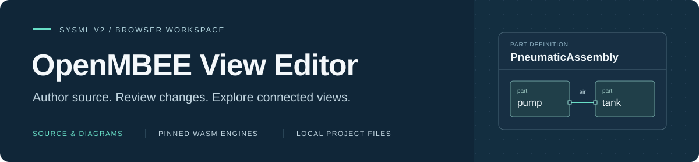
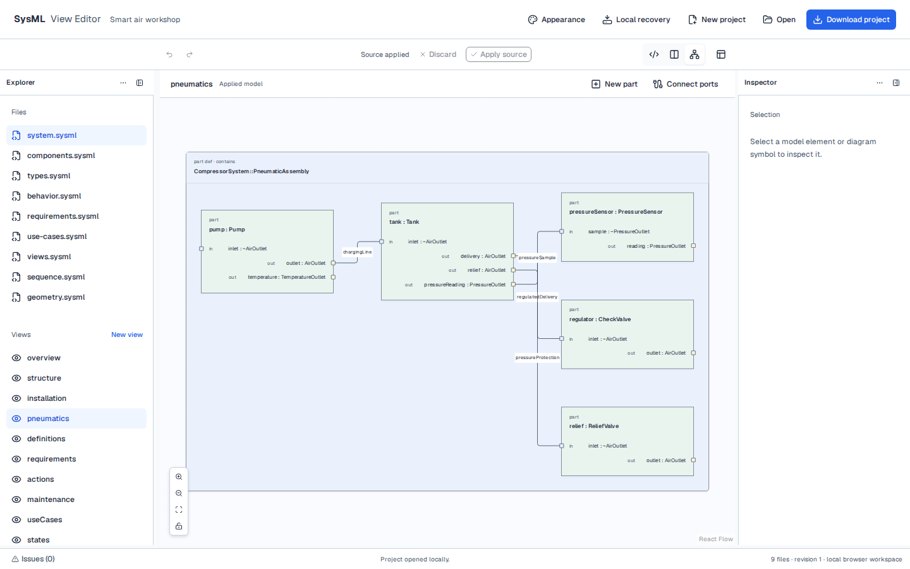

<p align="center">
  
</p>

<h1 align="center">OpenMBEE View Editor</h1>

<p align="center">
  Work with SysML v2 source and diagrams in your browser.<br />
  Review graphical edits as source changes, and keep your project in local files.
</p>

<p align="center">
  <a href="#scope"></a>
  <a href="LICENSE"></a>
  <a href=".nvmrc"></a>
  <a href="src/"></a>
  <a href="docs/architecture/README.md"></a>
</p>

<p align="center">
  <a href="https://openmbee-view-editor.vercel.app/app">Open live app</a> ·
  <a href="#quick-start">Quick start</a> ·
  <a href="#features">Features</a> ·
  <a href="#examples">Examples</a> ·
  <a href="#modeling-engines">Modeling engines</a> ·
  <a href="#documentation">Documentation</a> ·
  <a href="CONTRIBUTING.md">Contributing</a> ·
  <a href="SECURITY.md">Security</a>
</p>

---

> **Sandbox stage** — Actively iterating on the design and implementation. Features, interfaces and workflows may change. Not intended for production use.

[Try the hosted sandbox](https://openmbee-view-editor.vercel.app/app). Open a local project or choose **Load example** to explore the built-in model. The hosted app is deployed manually and may lag behind `develop`.

OpenMBEE View Editor brings source editing, named model views and reviewed graphical authoring into one local workbench. Open a multi-file model, inspect its structure and connections, review supported edits, then download the source and compatible diagram positions as one project.

**Source owns model semantics. Presentation owns geometry.** Renaming a part or connecting ports produces a reviewed source transaction; moving a symbol changes its position. The application runs locally in browser workers and requires no application backend.

<p align="center">
  
</p>

<p align="center"><em>Smart air workshop: a pneumatic assembly with typed ports and authored connections.</em></p>

## Features

- **Edit highlighted SysML source.** CodeMirror provides line numbers, bracket matching/closing, indentation, find/replace and draft undo/redo. Apply or discard changes, undo/redo accepted source transactions, and keep the last valid model when a draft fails validation.
- **Query the draft model.** Request engine-backed completion, symbol information and project-file definitions against the complete current source set.
- **Open source-defined views.** Navigate named SysML views independently of the active source file. Inspect nested parts, typed inherited ports and resolved connection endpoints.
- **Navigate source issues.** Open an issue’s reported file and line in the source editor. Missing or stale locations are explained while drafts and the last valid diagram are retained.
- **Browse the model hierarchy.** Expand packages, definitions and declared members in the Model tree. Inspect type/kind labels; use arrow keys, type-ahead and Enter/Space to navigate and select.
- **Review graphical changes.** Rename parts, create native views, add typed part usages and connect compatible directed ports through an exact source-change preview.
- **Preserve compatible layouts.** Keep verified symbol positions across supported edits, including inactive views. Unsafe identity mappings are reported and arranged again.
- **Keep projects portable.** Download applied source, unfinished drafts and compatible diagram positions together; reopen the bundle or import multiple SysML files.
- **Recover unfinished work.** Restore or discard one local browser recovery copy, with explicit storage errors and protection against competing tabs.
- **Arrange your workspace.** Resize or collapse Explorer, Inspector, source/diagram panes and Issues using dividers, keyboard controls or panel options.
- **Choose your appearance.** Use Light, Dark or Follow system, six diagram palettes and custom muted element colors. Theme and panel preferences stay in the browser.

Structural workflows have real-engine browser coverage; behavior, use-case, state, sequence and geometry renderers remain unavailable. See [capabilities and limits](docs/capabilities.md) and [local verification](docs/verification.md) for the implemented scope.

In the source editor, use **Ctrl+F** / **Cmd+F** for find/replace and **Ctrl+Z** / **Cmd+Z** for draft editing undo; **Ctrl+Y** / **Cmd+Shift+Z** redo draft edits. **Tab** moves focus out of the editor. Toolbar **Undo source** / **Redo source** operate on accepted model revisions. Highlighting is lexical; the pinned engines still validate source when you apply it. Use **Ctrl+Space** for engine-backed completion, **F1** for symbol information and **F12** for project-file definitions; pointing at a symbol also requests hover information. Queries use the complete current draft source set. Unsupported completion edits and stale replies are rejected. Formatting and inline diagnostics remain future work.

## Quick start

### 1. Install and run

Use **Node.js 26.3.1** from [`.nvmrc`](.nvmrc) and **npm 11.16.0**. From the repository root:

```bash
npm ci
npm run dev -- --host 127.0.0.1
```

Open the URL printed by Vite. The first dev/build verifies and prepares checksum-pinned browser engines. It needs network access, `tar` and disk space for the Go build cache. Linux x64 can download the pinned Go 1.25.11 toolchain into ignored `sandbox/`; on other platforms, set `SYSML_GO` to that Go version's binary. Later runs verify and reuse prepared assets. See [engine preparation](engine-bridge/README.md).

Vite excludes generated `sandbox/` contents and prepared `static/vendor/` binaries from development watching; app sources remain watched. If an older dev process reported `ENOSPC` from those directories, restart it with the current configuration.

### 2. Open the app or try an example

The landing page offers **Open app** and **Try an example**. `/app` opens a project launcher with **New project**, **Open files or project**, **Load example** and **Local recovery**. No model loads implicitly. New projects stay marked modified until downloaded.

Choose **Load example** to open **Smart air workshop** in Diagram mode. Its nine source files and fourteen named views cover reusable definitions, specialization, attributes, constraints, requirements, actions, states, use cases, sequences and geometry.

The starting **pneumatics** view shows the pump, tank, regulator, relief valve and pressure sensor, with thirteen ports and four connections:

1. Select another named view in Explorer or the diagram’s **Named view** selector to explore its contents.
2. Choose **Split** to see source beside the diagram; selecting a source file keeps the active view open.
3. Edit source and choose **Apply source**. Invalid drafts retain the previous applied model and appear in **Issues**.
4. Choose **Download project** to save your work before closing or reloading.

Six example views have partial structural/definition/tree rendering. The other eight evaluate through the engine and display an explicit unavailable-renderer message. The [model guide](examples/air-compressor/README.md) lists each view's current support.

### 3. Try graphical authoring

Use **Open** to select both SysML files from [`examples/assembly/`](examples/assembly/), then open `structure`:

- Select a part in Model or the diagram to review a rename.
- Choose **New part** in the diagram or **New part in selection** in the Inspector. Select an owner, name and existing part definition, then review and apply the change.
- Choose **Connect ports**, or select a directed port and choose **Connect selected port**. Select compatible usage-qualified endpoints, then review and apply the connection.
- Use source undo/redo, switch views and download/reopen the project to continue working.

Connection creation currently requires explicit compatible directions and identical resolved port types. Conjugated and ambiguous endpoint paths are unavailable for graphical creation. [Authoring workflow and supported subset](docs/architecture/graphical-authoring.md).

## Examples

Open all `.sysml` files from one example folder together. Each project has its own named views and recorded visual targets.

| Project                                                                                                                                                                 | Explore                                                                                                                |
| ----------------------------------------------------------------------------------------------------------------------------------------------------------------------- | ---------------------------------------------------------------------------------------------------------------------- |
| [Smart air workshop](examples/air-compressor/README.md)                                                                                                                 | A complete nine-file example spanning structure, requirements, behavior and geometry; the built-in launcher example    |
| [Nested assembly](examples/assembly/)                                                                                                                                   | Nested ownership, repeated usages, inherited ports, a connection and reference notation; the focused authoring fixture |
| [Parts](examples/parts/), [ports](examples/ports/) and [packages](examples/packages/)                                                                                   | Shared definitions, usage contexts, conjugation, imports and exposure                                                  |
| [Requirements](examples/requirements/), [use cases](examples/use-cases/), [actions](examples/actions/), [states](examples/states/) and [sequences](examples/sequences/) | Source constructs and named views, including explicit unavailable-renderer cases                                       |
| [Complete example library](examples/README.md)                                                                                                                          | Comments, documentation, filters, empty views and per-view support gaps                                                |

Engine evaluation, application rendering and intended visual quality are recorded separately. Passing an example does not establish full SysML v2 conformance.

## Modeling engines

The editor uses both OpenSysML and SysML Toolkit locally as WebAssembly in disposable browser workers:

| Engine        | Role in this editor                                                                                                                                      |
| ------------- | -------------------------------------------------------------------------------------------------------------------------------------------------------- |
| OpenSysML     | Parses and validates source, resolves declarations and types for model inspection, and evaluates named SysML views into semantic diagram data.           |
| SysML Toolkit | Proposes source transformations for rename, new view, new part and connect ports, returning edit evidence used to preserve compatible diagram positions. |

- **Apply source:** OpenSysML parses and validates the edited source; affected views are reevaluated.
- **Graphical authoring:** Toolkit proposes a source change, OpenSysML validates the complete result, and the workspace checks the command's intended outcome before review and acceptance.
- **Move symbols:** only presentation geometry changes; moving a symbol does not transform semantic source.

React Flow draws the interactive diagrams and ELK supplies automatic layout. The workspace owns drafts, transaction acceptance, undo/redo and layout-preservation rules. See [engine pins, preparation and provenance](engine-bridge/README.md) and the [workspace architecture](docs/architecture/README.md).

## Projects and workspace

Use **Projects** to return to the launcher and **Resume project** to continue. The live workbench stays mounted while you browse the launcher or landing page, retaining source drafts, accepted history, selection and diagram state. A full reload starts at the launcher; existing browser recovery is offered explicitly. Landing and app share one appearance preference controller.

Folder write-back, Flexo project/branch checkout and automatic diagrams for models without named views remain planned. Opening source imports copies; it does not connect to a folder or remote branch.

**Download project** saves one `.sysml-project.json`; **Open** accepts that bundle or multiple `.sysml` files. Downloads do not write back to the imported folder. **Local recovery** keeps one recovery copy in this browser using IndexedDB, including applied source, unapplied drafts, diagram positions and the active file/view. On reload, choose **Restore recovery** or **Discard recovery** before new work can replace that copy. The dialog can disable local saving or retry storage failures. Browser storage can be cleared; retain downloaded projects as portable backups. Restored work remains modified until downloaded. With saving enabled, returning to a clean project clears this session’s older recovery; a competing tab cannot silently overwrite a newer copy.

| Data                                                             | Where it lives                                              |
| ---------------------------------------------------------------- | ----------------------------------------------------------- |
| Applied source, unapplied drafts and compatible symbol positions | Downloaded project bundle                                   |
| Unfinished project plus active file/view                         | One local IndexedDB recovery copy; explicit restore/discard |
| Theme, palette, custom colors and panel arrangement              | Browser preferences; separate from project content          |
| Undo history, selection and camera                               | Current session; not restored from the project bundle       |

Drag a divider or focus it and use arrow keys to resize a panel. Header options provide button alternatives. Reopen collapsed tools from their edge rails, open **Issues** from the footer, or use **Workspace layout** to adjust/reset the arrangement. Below 900 px, the source/diagram split becomes vertical. [Panel behavior](docs/architecture/workbench-layout.md).

Use **Appearance** for Light/Dark/System, palettes and custom muted fills. Preferences never modify source, project files or model undo history. [Design system](docs/design-system.md).

## Development

Use the committed npm lockfile and the Node version in `.nvmrc`.

If `just` is installed, the root `justfile` provides shortcuts for the npm scripts. Run `just` to list commands:

```bash
just install                        # npm ci
just dev --host 127.0.0.1
just check
just build
just install-browser
just test-e2e --project=functional --grep 'downloads and reopens'
just preview --host 127.0.0.1
```

Script names containing colons use hyphens in recipes: `just engines-prepare`, `just check-architecture`, `just examples-index`, `just test-examples` and `just test-e2e`. Recipes with arguments forward them to the underlying command, preserving quoted values. Node selection and npm scripts remain unchanged; `just` is optional.

```bash
npm run check                       # formatting, architecture, types and unit checks
npm run build                       # prepare engines and build static output
npx playwright install chromium
npm run test:e2e                    # fresh build, real engines and visual comparisons
npm run preview -- --host 127.0.0.1
```

PR CI runs all fast checks plus twelve critical browser workflows, adding visual comparisons for code changes. Full browser coverage runs weekly, manually and for release/main/hotfix PRs and pushes. Run `npm run test:e2e -- --project=functional --grep @critical` to reproduce the smaller browser gate; `npm run test:e2e` still runs everything. See [CI coverage](docs/testing.md#ci-coverage) for selection and deferred coverage.

Functional checks can use installed Chrome with `PLAYWRIGHT_BROWSER_CHANNEL=chrome npm run test:e2e -- --project=functional`. Visual comparisons always use bundled Chromium and reviewed platform-specific baselines. The browser suite starts its own fresh production server; port **4175** must be free. See [browser testing and baseline review](docs/testing.md).

Production hosting must serve `index.html` for direct `/app` navigation while retaining normal asset paths; use the SPA fallback for your hosting provider. `/app/?example=1` is canonicalized to `/app` before the explicitly requested example opens, and reload does not repeat that opening action.

For example changes, run `npm run test:examples`; use `npm run examples:index` after updating the catalog. `npm run format` formats owned source and docs; `npm run lint` checks formatting and architectural imports. Keep temporary files, reports and captures under ignored `sandbox/`.

## Documentation

Start with the [documentation index](docs/README.md) for current capabilities, architecture contracts, design conventions, testing evidence and planned work. Engine preparation and provenance live in the [engine guide](engine-bridge/README.md); model fixtures and visualization targets live in the [example library](examples/README.md).

## Scope

This implementation supports a bounded source/structure editing workflow. It does not claim complete SysML v2 language, notation, execution or interchange conformance. Owned-port boundary notation, effective conjugated directions, behavior renderers and broader editing commands remain explicit gaps.

Flexo MMS checkout and publishing are planned; the current workbench uses local project files. Read the [integration research](docs/research/openmbee-flexo-mms.md) and [roadmap](docs/next-steps.md#3-flexo-checkout-then-reviewed-publication) for the proposed direction.

## Contributing

The default branch, `develop`, holds ongoing sandbox work. Feature PRs target `develop`; releases and hotfixes follow the [Git Flow workflow](docs/git-workflow.md). `main` requires a code-owner approval and passing CI.

Start with the [contribution guide](CONTRIBUTING.md), [architecture](docs/architecture/README.md) and the acceptance criteria in [next steps](docs/next-steps.md). Keep changes focused, preserve license/provenance notices and request approval before adding production dependencies. Use the [project repository](https://github.com/Open-MBEE/sysml_view_editor) for bugs and feature requests.

## Security

Report suspected vulnerabilities privately to repository maintainers following the [security policy](SECURITY.md). Keep credentials, personal workstation details and private models out of public reports and captures.

## License

Released under the [Apache License, Version 2.0](LICENSE). Reused engine sources, UI primitives, fonts and other assets retain their [copyright and provenance notices](NOTICE).
